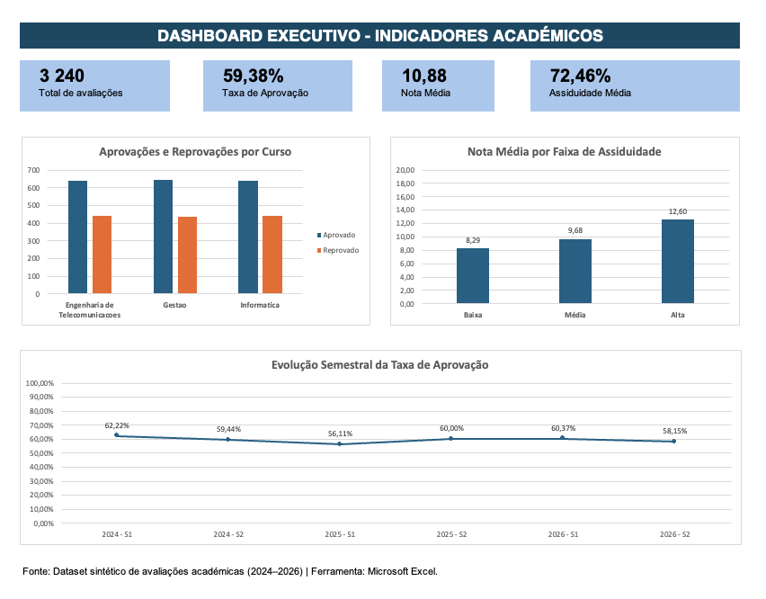

# Análise de Indicadores Académicos

### Projeto de Portfólio | Data Analytics

## Sobre o projeto

Este projeto tem como objetivo analisar indicadores de desempenho académico de uma instituição de ensino fictícia, utilizando Microsoft Excel para transformar dados em informações relevantes para a tomada de decisões.

A análise abrange 3.240 registos sintéticos de avaliações, distribuídos por três cursos e seis semestres, entre 2024 e 2026.

## Objetivos

- Analisar as taxas de aprovação e reprovação.
- Comparar o desempenho académico entre cursos.
- Investigar a associação entre assiduidade e notas.
- Avaliar a evolução temporal dos resultados.
- Desenvolver um dashboard executivo para acompanhamento de KPIs.

## Ferramentas e competências

- Microsoft Excel
- Tabelas Dinâmicas
- Fórmulas e funções
- Validação de dados
- Estatística descritiva
- Visualização de dados
- Git e GitHub

## Principais indicadores

| Indicador | Resultado |
|---|---|
| Avaliações analisadas | 3.240 |
| Taxa de aprovação | 59,38% |
| Nota média | 10,88/20 |
| Assiduidade média | 72,46% |

## Dashboard Executivo

## Principais insights

**1. Desempenho por curso**

Os três cursos apresentaram taxas de aprovação próximas de 59%, com Gestão a registar o valor mais elevado.

**2. Assiduidade e desempenho**

As avaliações com alta assiduidade apresentaram nota média de 12,60, enquanto as de baixa assiduidade apresentaram 8,29.

**3. Evolução temporal**

A taxa de aprovação variou entre 56,11% e 62,22% durante os seis semestres analisados.

## Metodologia

1. Preparação e exploração dos dados.
2. Verificação da qualidade e consistência.
3. Construção de indicadores académicos.
4. Análise com Tabelas Dinâmicas.
5. Criação de gráficos e dashboard.
6. Interpretação e documentação dos resultados.

## Limitações

Os dados são sintéticos e foram utilizados exclusivamente para fins educativos e de demonstração de competências.

As análises são descritivas e não estabelecem relações causais.

## Próximas melhorias

- Desenvolvimento de dashboard em Power BI.
- Modelação de dados e medidas DAX.
- Introdução de análises com SQL.
- Automatização do processo de atualização.

## Autor

**Ruben Kuyota**

Projeto desenvolvido para demonstrar competências práticas em análise de dados e Business Intelligence.
